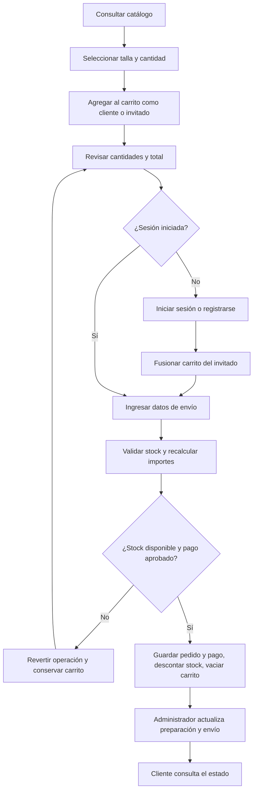

# BlackCODE: alcance y proceso

Empresa ficticia de accesorios para hombre: anillos, cadenas y pulseras.
El prototipo automatiza el registro de compras, cálculo de importes, control de stock,
seguimiento de pedidos y mantenimiento del catálogo.

## Referencias de diseño

- Vitaly: composición del catálogo y filtros a la izquierda, también después de buscar.
- Zaro: inicio con bloque principal, accesos a colecciones y productos destacados.
- RKS: navegación con submenús al pasar el cursor y barra visible al desplazarse.
- Interfaz en español y paleta blanco, negro y gris.
- Se usan ilustraciones propias del prototipo, sin copiar fotografías de las tiendas.

## Módulos

| Módulo | Pantallas |
|---|---|
| Autenticación | Login compartido por rol, registro, acceso restringido |
| Catálogo | Inicio, búsqueda y filtros, detalle con talla y stock |
| Carrito | Artículos, cantidades, eliminar, resumen e invitado |
| Pedidos y pagos | Datos de envío, tarjeta/transferencia simuladas, confirmación, listado y seguimiento |
| Administración | Indicadores, CRUD de productos y stock, gestión de estados, reportes CSV/JSON |

## Proceso de compra

Las operaciones críticas de compra se ejecutan dentro de una transacción.
Las cancelaciones permitidas restauran el stock. Un pedido enviado ya no puede cancelarse según las reglas originales.

## Archivos para sustentar el carrito de Angelo

- `Application/Features/Carrito/CarritoService.cs`: gestión de artículos y fusión.
- `Application/Features/Carrito/CalculoCarritoService.cs`: importes, envío y reglas de descuento.
- `Application/Features/Carrito/CarritoDtos.cs`: contratos y datos de entrada/salida.
- `Web/Controllers/CarritoController.cs`: acciones HTTP sin acceso directo a la base.
- `Web/Models/TiendaViewModels.cs`: ViewModels y mapeo manual.
- `Web/Views/Carrito/Index.cshtml`: pantalla.
- `Web/wwwroot/css/carrito.css`: estilos de la pantalla.

Los nombres de carpetas anteriores se encuentran dentro de los proyectos BlackCode.Application y BlackCode.Web, respectivamente.
